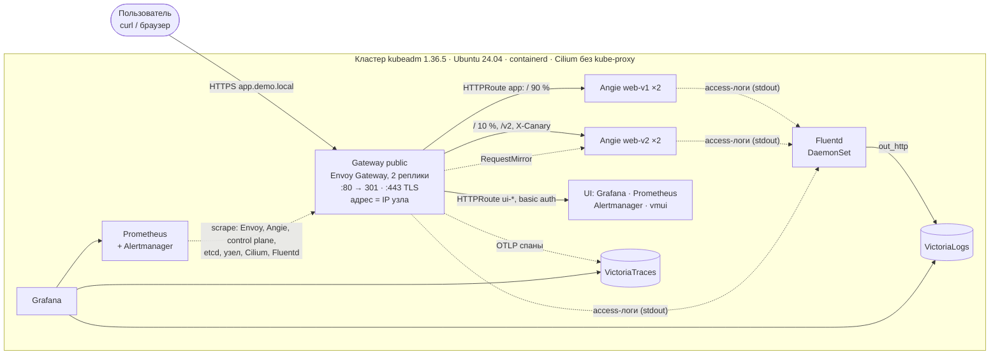

# kubeadm + Gateway API + observability

[](https://github.com/Kurligin/kubeadm-gateway-observability/actions/workflows/lint.yml)
[](https://github.com/Kurligin/kubeadm-gateway-observability/actions/workflows/e2e.yml)

Одна команда на чистой Ubuntu 24.04 поднимает кластер Kubernetes на kubeadm,
публикует веб-приложение через Gateway API (Envoy Gateway), собирает метрики
(Prometheus), логи (Fluentd → VictoriaLogs) и трейсы, а `make verify`
сквозными запросами доказывает, что всё это работает.

## TL;DR

На Ubuntu 24.04 amd64 (4 vCPU / 8 ГБ / 30 ГБ, sudo, интернет). `./deploy.sh`
идёт ~8–10 мин, повторный запуск — ~40–50 с и ничего не меняет;
`make verify` — 45–90 с (на двух узлах дольше): таблица проверок, код
возврата 0 — всё работает.

```bash
git clone https://github.com/Kurligin/kubeadm-gateway-observability.git
cd kubeadm-gateway-observability
./deploy.sh
make verify
```

Фрагмент вывода `make verify` на стенде: один узел, трейсинг включён
(29 проверок и 2 пропуска; с выключенным трейсингом шаг 10 тоже
пропускается, с воркером — `Passed: 35, failed: 0, skipped: 1`):

```text
 ✓  3   HTTPS -> 200 "Hello World!"                  200, TLS verified by the demo CA: Hello World! version=v1 pod=web-v1-…
 ✓  4   Canary split (weights 90/10)                 v2: 20/200 = 10 % (expected 5-20 %, weight 10 %)
 ✓  6   Request ID in VictoriaLogs (<= 45 s)         X-Request-ID verify-… found in Angie and Envoy access logs after 9 s
 ✓  7   Prometheus: key targets up                   16 key jobs, … targets, all up
Passed: 29, failed: 0, skipped: 2
RESULT: OK
```

[Описание](#краткое-описание) · [Архитектура](#архитектура) · [Версии](#технологии-и-версии) · [Gateway API](#gateway-api) · [Требования](#требования-к-среде) · [Развёртывание](#развёртывание) · [Проверка](#проверка) · [Доп. возможности](#дополнительные-возможности) · [CI/CD](#cicd) · [Ограничения](#известные-ограничения) · [Документация](#документация)

## Краткое описание

| Обязательный пункт | Как сделано | Проверка |
|---|---|---|
| Kubernetes | **1.36.5**, кластер создаётся **kubeadm** (Ansible), без kube-proxy, CNI Cilium; один узел, воркеры — `make add-worker` | `make verify`, шаг 1 |
| Веб-приложение | Angie 1.12.2 (публичный образ `docker.angie.software/angie`), версии `web-v1`/`web-v2`, ответ `Hello World! version=v1 pod=…`, JSON access-лог | [проверка](#1-приложение-через-gateway-api) |
| Gateway API | Envoy Gateway 1.9.2, Gateway API v1.6.1 (standard): GatewayClass, Gateway, HTTPRoute → Service приложения | [Gateway API](#gateway-api) |
| Мониторинг | Prometheus (kube-prometheus-stack), больше 20 заданий сбора: Envoy, Angie, control plane, etcd, узел, Cilium, Fluentd… | [проверка](#2-мониторинг) |
| Логирование | Fluentd (DaemonSet) собирает access/error-логи Angie и Envoy → VictoriaLogs | [проверка](#3-логирование) |
| Ubuntu 24.04 | проверено на Ubuntu 24.04.5 LTS (amd64) и раннере GitHub `ubuntu-24.04` | [требования](#требования-к-среде) |
| Автоматизация | `./deploy.sh` → Ansible (узел, кластер) + helmfile (платформа); идемпотентно | [развёртывание](#развёртывание) |

## Архитектура



Gateway получает IP узла через Cilium node IPAM (без MetalLB и NodePort),
TLS `*.demo.local` выпускает cert-manager. `X-Request-ID` и `trace_id`
связывают один запрос в логах Envoy и Angie и в трейсе. Алерты и SLO идут
Alertmanager → webhook-получатель → логи. По умолчанию включены NetworkPolicy
default-deny, Pod Security `restricted`, генерация паролей, образы по digest.
Потоки, namespaces и обоснование выбора — [docs/architecture.md](docs/architecture.md).

## Технологии и версии

Источник истины — [`versions.env`](versions.env) (`make versions`).

| Компонент | Версия | Роль |
|---|---|---|
| Ubuntu | 24.04 LTS (проверено 24.04.5), amd64 | ОС узла |
| Kubernetes (kubeadm, kubelet, kubectl) | **1.36.5** | кластер, создаётся `kubeadm init` |
| containerd / runc | 2.3.6 / 1.4.3 | рантайм контейнеров |
| Cilium | 1.20.2 | CNI, замена kube-proxy, node IPAM, Hubble |
| Envoy Gateway / Envoy | 1.9.2 / 1.39.1 | реализация Gateway API |
| Gateway API (CRD, канал standard) | v1.6.1 | Gateway, HTTPRoute, ReferenceGrant |
| cert-manager | 1.21.2 | демо-CA и TLS-сертификаты |
| Angie | 1.12.2 (`-minimal`) | демо-приложение |
| kube-prometheus-stack | чарт 91.8.2 | Prometheus 3.15.0, Alertmanager 0.34.1, Grafana 13.2.3, Prometheus Operator 0.94.1, node-exporter 1.12.1, kube-state-metrics 2.20.0 |
| kube-rbac-proxy | 0.22.1 | метрики etcd и node-exporter по токену |
| Fluentd | 1.19.3 (`fluentd-kubernetes-daemonset` v1.19.3-debian-forward-1.1) | сбор логов |
| VictoriaLogs / VictoriaTraces | 1.51.1 / 0.11.1 | хранилища логов и трейсов |
| metrics-server | 0.9.0 | `kubectl top` |
| local-path-provisioner | 0.0.37 | StorageClass по умолчанию |
| ansible-core | 2.18.19 ([`requirements.txt`](requirements.txt)) | подготовка узла и кластера |
| Helm / helmfile / helm-diff | 3.22.0 / 1.8.1 / 3.15.15 | установка платформы |

## Gateway API

**Реализация — Envoy Gateway 1.9.2, Gateway API v1.6.1, канал standard**
(CRD — из чарта `gateway-crds-helm` той же версии). Манифесты —
[`charts/gateway`](charts/gateway) и [`charts/ui-routes`](charts/ui-routes).

| Ресурс | Имя | Зачем |
|---|---|---|
| GatewayClass | `eg` | класс Envoy Gateway, параметры — EnvoyProxy `node-lb` |
| Gateway | `gateway/public` | listeners `http` :80 и `https` :443 (TLS, Secret `demo-tls` от cert-manager) |
| HTTPRoute | `https-redirect` | любой запрос на :80 → 301 на `https://` |
| HTTPRoute | `app` | `app.demo.local`: `/v2` → web-v2; `X-Canary: true` → web-v2; `/` → web-v1 90 % / web-v2 10 % + `RequestMirror`; `Request/ResponseHeaderModifier`, `timeouts.request: 10s` |
| HTTPRoute | `app-limited` | `/limited` → web-v1 с жёстким rate limit (демонстрация 429) |
| HTTPRoute | `ui-grafana`, `ui-prometheus`, `ui-alertmanager`, `ui-logs`, `ui-traces` | UI наблюдаемости на том же Gateway, только нужные методы и пути (`ui-traces` — если включён трейсинг) |
| ReferenceGrant | `demo/routes-from-gateway`, `*/ui-routes-from-gateway` | маршрутам из `gateway` разрешено ссылаться на Service в `demo`, `monitoring`, `logging`, `tracing` |
| EnvoyProxy | `envoy-gateway-system/node-lb` | Service LoadBalancer с IP узла (Cilium node IPAM), 2 реплики + PDB, образ по digest, трейсинг |
| ClientTrafficPolicy | `public` | `X-Request-ID`: сохранить клиентский или сгенерировать |
| BackendTrafficPolicy | `app`, `app-limited`, `ui-*` | таймаут соединения, безопасные ретраи, локальный rate limit (500/с и 10/мин на реплику); на `ui-*` трейсинг выключен |
| SecurityPolicy | `ui-prometheus`, `ui-alertmanager`, `ui-logs`, `ui-traces` | basic auth (у этих UI нет своей аутентификации) |

Проверка на узле, из каталога репозитория (`make ca` пишет корень демо-CA
в `./ca.crt`):

```bash
make ca
IP=$(kubectl -n gateway get gateway public -o jsonpath='{.status.addresses[0].value}')
curl --cacert ca.crt --resolve app.demo.local:443:$IP https://app.demo.local/
```

```text
Hello World! version=v1 pod=web-v1-…
```

## Требования к среде

| | Минимум | Рекомендуется |
|---|---|---|
| ОС | Ubuntu 24.04 LTS, amd64 | то же |
| CPU / ОЗУ | 2 vCPU / 4 ГБ (трейсинг выключится сам) | 4 vCPU / 8 ГБ (трейсинг включится сам) |
| Диск | 20 ГБ | 30 ГБ |

Ещё нужны постоянный IP узла, `sudo` (с паролем или без) или root,
интернет (apt, pkgs.k8s.io, GitHub, реестры) — напрямую или через прокси.
Проверено: ВМ Proxmox 4/8 (Ubuntu 24.04.5) — один узел и с воркером 2/4; ВМ
2/4; раннер GitHub `ubuntu-24.04`; Vagrant (libvirt); узел только за прокси.
Замеры — [docs/operations.md](docs/operations.md#ресурсы-память-и-диск).

## Развёртывание

1. `git clone` и `./deploy.sh` на узле (как в [TL;DR](#tldr)): скрипт ставит
   `python3-venv` и `make`, создаёт `.venv` с Ansible и вызывает `make deploy`.
2. `make cluster` — Ansible: узел, containerd, пакеты Kubernetes, `kubeadm init`.
3. `make platform` — helmfile: Cilium, cert-manager, Envoy Gateway, приложение,
   маршруты, Prometheus, Fluentd, VictoriaLogs/Traces, UI.
4. В конце — подсказка: `make verify`, `make status`, `make ui` (адреса и
   пароли UI), `make ca`. Повторный `./deploy.sh` ничего не меняет.

| Ситуация | Как (подробно — [docs/operations.md](docs/operations.md)) |
|---|---|
| несколько сетевых интерфейсов | `NODE_IP=10.0.0.5 ./deploy.sh` |
| от root | `sudo ./deploy.sh` (переменные — после sudo: `sudo NODE_IP=… ./deploy.sh`) |
| интернет только через прокси | `HTTP_PROXY=http://proxy:3128 HTTPS_PROXY=http://proxy:3128 ./deploy.sh` |
| нет Ubuntu 24.04 под рукой | `vagrant up` (VirtualBox или libvirt, хост amd64) |
| трейсинг явно | `TRACING=true ./deploy.sh` или `TRACING=false ./deploy.sh` |
| второй узел | `make add-worker WORKER=<IP> WORKER_USER=ubuntu SSH_KEY=~/.ssh/id_ed25519` ([ниже](#несколько-узлов)) |
| удалить кластер | `make destroy FORCE=1` |

### Несколько узлов

Воркер — Ubuntu 24.04 amd64, доступный с control plane по SSH. Перед
`make add-worker` на control plane: ключ SSH (если его ещё нет), ключ на
воркер (`ssh-copy-id` заодно запоминает host key воркера в
`~/.ssh/known_hosts`), проверка входа и `sudo` без пароля — она должна
напечатать `ok`. Адрес `192.0.2.21` и пользователь — ваши.

```bash
ssh-keygen -t ed25519 -N '' -f ~/.ssh/id_ed25519
ssh-copy-id -i ~/.ssh/id_ed25519.pub ubuntu@192.0.2.21
ssh -i ~/.ssh/id_ed25519 ubuntu@192.0.2.21 'sudo -n true && echo ok'
make add-worker WORKER=192.0.2.21 WORKER_USER=ubuntu SSH_KEY=~/.ssh/id_ed25519
```

Если `sudo` на воркере спрашивает пароль (`sudo: a password is required`),
запустите последнюю команду как
`ANSIBLE_BECOME_ASK_PASS=true make add-worker …`: Ansible один раз спросит
`BECOME password` (он же используется для control plane, поэтому пароль
`sudo` на обоих узлах должен совпадать, или на control plane `sudo` без
пароля). `make add-worker` — 1,5–2 мин, затем `make verify` (35 проверок).
Подробнее — [docs/operations.md](docs/operations.md#несколько-узлов).

## Проверка

`make verify` на узле делает всё описанное ниже сам (около 30 проверок в 10
шагах, 45–90 с, таблица — [docs/verification.md](docs/verification.md)); с
другой машины: `GATEWAY_IP=$IP CA_FILE=ca.crt UI_PASSWORD=$PASS ./scripts/verify.sh`.

Команды ниже можно копировать целиком в bash и zsh (в том числе в zsh
macOS по умолчанию): комментариев внутри блоков нет, ожидаемый вывод —
отдельным блоком.

**Переменные** — один раз в сессии (bash и zsh; нужны `curl` и `jq`). На
узле, из каталога репозитория:

```bash
make ca
IP=$(kubectl -n gateway get gateway public -o jsonpath='{.status.addresses[0].value}')
PASS=$(kubectl -n gateway get secret ui-basic-auth -o jsonpath='{.data.password}' | base64 -d)
```

Или со своей машины в той же сети (адрес и пользователь SSH — ваши):

```bash
IP=192.168.1.38
ssh ubuntu@$IP 'cd kubeadm-gateway-observability && make ca >/dev/null && cat ca.crt' > ca.crt
PASS=$(ssh ubuntu@$IP 'kubectl -n gateway get secret ui-basic-auth -o jsonpath={.data.password} | base64 -d')
```

Дальше — curl к Gateway без DNS (`--resolve` подставляет IP для всех имён
`*.demo.local`, включая Grafana и Alertmanager), с проверкой сертификата:

```bash
gwcurl() {
  curl -sS --noproxy '*' --cacert ca.crt \
    --resolve "app.demo.local:443:$IP" --resolve "grafana.demo.local:443:$IP" \
    --resolve "prometheus.demo.local:443:$IP" --resolve "alertmanager.demo.local:443:$IP" \
    --resolve "logs.demo.local:443:$IP" --resolve "traces.demo.local:443:$IP" "$@"
}
```

### 1. Приложение через Gateway API

Ответ приложения, маршрут `/v2` (всегда v2), раскладка canary на 100
запросах и редирект HTTP → HTTPS:

```bash
gwcurl https://app.demo.local/
gwcurl https://app.demo.local/v2
for i in $(seq 100); do gwcurl https://app.demo.local/; done | awk '{print $3}' | sort | uniq -c
curl -sS -o /dev/null -w '%{http_code} %{redirect_url}\n' -H 'Host: app.demo.local' http://$IP/
```

```text
Hello World! version=v1 pod=web-v1-…
Hello World! version=v2 pod=web-v2-…
  90 version=v1
  10 version=v2
301 https://app.demo.local/
```

### 2. Мониторинг

Метрики: Envoy (запросы, коды, задержки по маршрутам, 429), Angie (запросы
по версиям и кодам), control plane, etcd, CoreDNS, kubelet, node-exporter,
kube-state-metrics (и статус Gateway), Cilium, Fluentd, хранилища. Цели
(все `up`) и запрос PromQL:

```bash
gwcurl -u "admin:$PASS" https://prometheus.demo.local/api/v1/targets \
  | jq -r '.data.activeTargets[] | .health + " " + .labels.job' | sort | uniq -c
gwcurl -u "admin:$PASS" -G https://prometheus.demo.local/api/v1/query \
  --data-urlencode 'query=sum by (version) (angie_http_server_zones_requests_total{zone="app"})' \
  | jq -c '.data.result[] | {version: .metric.version, requests: .value[1]}'
```

```text
   1 up apiserver
   2 up envoy
   …
{"version":"v1","requests":"977"}
{"version":"v2","requests":"119"}
```

Grafana (`https://grafana.demo.local`, пароль — `make ui`): дашборды «Demo
app — golden signals» и «Gateway / SLO». Без правки `/etc/hosts` её можно
открыть в Chrome с правилом резолвинга или через SSH-туннель —
[docs/verification.md](docs/verification.md#веб-интерфейсы). Больше
запросов — [docs/verification.md](docs/verification.md#7-мониторинг).

### 3. Логирование

Fluentd собирает логи всех контейнеров (access/error-логи Angie, access-лог
Envoy — JSON в поля), добавляет namespace, под, контейнер и шлёт в
VictoriaLogs на 7 дней. Запрос с уникальным `X-Request-ID` — в логах три
записи: Angie (`traffic: app`), Angie (`traffic: shadow` — копия зеркала) и
Envoy:

```bash
RID="check-$(date +%s)"
gwcurl -H "X-Request-ID: $RID" https://app.demo.local/
sleep 15
gwcurl -u "admin:$PASS" https://logs.demo.local/select/logsql/query \
  --data-urlencode "query=x_request_id:\"$RID\"" \
  | jq -c '{_time, container: ."kubernetes.container_name", traffic, status, uri}'
```

UI логов — `https://logs.demo.local/select/vmui/` (`admin` / `$PASS`).

### 4. Трейсинг (если включён)

Запрос со своим `traceparent`, через 30 с — его трейс: спаны `ingress`,
`router … egress` и `mirror`:

```bash
TID=$(openssl rand -hex 16)
gwcurl -H "traceparent: 00-$TID-$(openssl rand -hex 8)-01" https://app.demo.local/
sleep 30
gwcurl -u "admin:$PASS" https://traces.demo.local/select/jaeger/api/traces/$TID \
  | jq -r '.data[0].spans[]?.operationName'
```

## Дополнительные возможности

| Улучшение | Как проверить («шаг N» — строки `make verify`) |
|---|---|
| Canary 90/10, маршруты по пути `/v2` и заголовку `X-Canary` | `make verify`, шаг 4 |
| Зеркалирование (`RequestMirror`), фильтры заголовков, `timeouts` HTTPRoute | шаги 4, 6 |
| HTTP → HTTPS (301), TLS от cert-manager | шаг 3 |
| Rate limit (429), безопасные ретраи, таймауты (BackendTrafficPolicy) | шаг 5 |
| Envoy в 2 репликах с PodDisruptionBudget | `kubectl -n envoy-gateway-system get pods,pdb` |
| Сквозной `X-Request-ID` в логах Envoy и Angie | шаг 6 |
| Метрики всего control plane, etcd через kube-rbac-proxy, metrics-server с проверкой TLS | шаг 7, `kubectl top nodes` |
| Дашборды golden signals и «Gateway / SLO» | Grafana |
| 13 алертов + SLO 99,9 % и 99 % < 250 мс с multi-window burn-rate, unit-тесты `promtool` | `make lint`, [демо алертов](docs/verification.md#демонстрация-алертов) |
| Доставка алертов: Alertmanager → webhook → VictoriaLogs (Watchdog) | шаг 7 |
| Трейсинг Envoy → VictoriaTraces, связь лог ↔ трейс в Grafana | шаг 10 |
| UI на Gateway: basic auth, наружу только чтение | шаг 8 |
| NetworkPolicy default-deny, Pod Security `restricted`, порты метрик узла закрыты nftables | шаг 8, [docs/security.md](docs/security.md) |
| Пароли генерируются при деплое, секретов в git нет | `make ui` |
| Все образы по digest, бинарники по sha256, предзагрузка `make images` | `make lint`, [`images.txt`](images.txt) |
| Работа через HTTP(S)-прокси | [docs/operations.md](docs/operations.md#прокси) |
| Несколько узлов: `make add-worker` / `make remove-worker` | шаг 9 |
| Vagrant для тех, у кого нет Ubuntu 24.04 | `vagrant up` |
| CI: lint + kubeconform + trivy + kube-linter; e2e на `ubuntu-24.04` с проверкой идемпотентности | бейджи вверху |

## CI/CD

- [`lint`](.github/workflows/lint.yml), каждый push: `make lint` — shellcheck, yamllint, ansible-lint, helm lint, promtool, ruff/black, unit-тесты, digest образов, kubeconform, trivy, kube-linter.
- [`e2e`](.github/workflows/e2e.yml), push в `main`, раннер `ubuntu-24.04`: `./deploy.sh` → `make verify` → повторный `./deploy.sh` без изменений → `make verify` ([подробно](docs/operations.md#cicd)).

## Известные ограничения

- **Один control plane**, etcd без HA; IPv4, только amd64; тома local-path
  привязаны к control plane. IP узла после создания кластера не меняется.
- **Self-signed CA** и домен `*.demo.local`: нужны `ca.crt` и `--resolve`.
- **Rate limit локальный** — на реплику Envoy (Gateway пропускает до 2×).
- **Алерты не уходят из кластера** (получатель пишет их в лог); SLO за 30
  дней оценивается по 3 дням метрик.
- **Плагин VictoriaLogs для Grafana** качается с grafana.com при старте.
- **Трейсинг** — только спаны Envoy, sampling 100 %; запросы со своим
  `X-Request-ID` не в формате UUID не трассируются; VictoriaTraces — 0.x.
- **Исходящий трафик подов не ограничен**; `kubeadm upgrade` не
  автоматизирован; e2e в CI — только одноузловой; платформа по SSH не ставится.
- **Cilium при установке печатает `WARNING: TLS is not enabled for the Hubble
  Relay server`**: без TLS только gRPC-сервер Hubble Relay (Service ClusterIP,
  снаружи кластера недоступен, клиент — `hubble` с узла); связь Relay с
  подами `cilium-agent` идёт по mTLS (сертификаты выпускает CronJob Cilium).
- **Сброс узла** (`kubeadm reset` в `make remove-worker` и `make destroy`,
  на воркере чаще) может печатать ошибки `StopPodSandbox … DeadlineExceeded`:
  reset останавливает все поды разом, и если `cilium-agent` остановлен раньше
  остальных, сеть их подов не снимается через CNI за отведённое время. Поды
  всё равно удаляются, команда завершается успешно — это шум.

## Документация

- [architecture.md](docs/architecture.md) — потоки, namespaces, NetworkPolicy, алерты и SLO, узлы, обоснование выбора
- [verification.md](docs/verification.md) — все шаги `make verify`, ручные проверки, UI, демо алертов
- [operations.md](docs/operations.md) — команды, прокси, Vagrant, трейсинг, воркеры, обновление, ресурсы, CI, проблемы
- [security.md](docs/security.md) — модель угроз и меры
