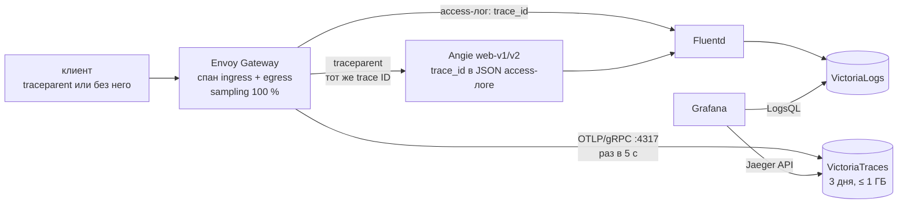

# Архитектура

Подробности к разделу «Архитектура» [README](../README.md): из чего состоит
решение, как идут трафик, метрики, логи и трейсы, как разделены namespaces и
почему выбраны именно эти компоненты. Безопасность — в
[security.md](security.md), проверка — в [verification.md](verification.md),
эксплуатация — в [operations.md](operations.md).

- [Слои решения](#слои-решения)
- [Порядок развёртывания](#порядок-развёртывания)
- [Трафик: Gateway API](#трафик-gateway-api)
- [Метрики](#метрики)
- [Логи](#логи)
- [Трейсы](#трейсы)
- [Алерты и SLO](#алерты-и-slo)
- [Namespaces и Pod Security](#namespaces-и-pod-security)
- [Сетевые политики](#сетевые-политики)
- [Несколько узлов](#несколько-узлов)
- [Почему так: ключевые решения](#почему-так-ключевые-решения)
- [Детали узла](#детали-узла)

## Слои решения

| Слой | Инструмент | Что делает |
|---|---|---|
| Узел | Ansible, роль `node_prep` | пакеты, модули `overlay`/`br_netfilter`, sysctl, отключение swap |
| Рантайм | Ansible, роль `containerd` | containerd и runc из официальных релизов с проверкой sha256, конфиг целиком из шаблона |
| Kubernetes | Ansible, роли `kube_packages`, `kubeadm_init` | kubeadm/kubelet/kubectl из pkgs.k8s.io (проверка отпечатка ключа, apt pinning, hold), `kubeadm init` без kube-proxy, kubeconfig |
| Инструменты | Ansible, роль `helm_tools` | helm, helmfile, плагин helm-diff |
| Порты метрик на узле | Ansible, роль `node_firewall` | nftables: порты метрик Cilium, node-exporter и API cilium-health доступны только с самого узла, из сети подов и с других узлов кластера |
| Воркеры | Ansible, роли `kubeadm_join`, `cluster_nodes` | `make add-worker` / `make remove-worker` (см. [«Несколько узлов»](#несколько-узлов)) |
| Сеть, хранилище | helmfile | Cilium (kube-proxy replacement, node IPAM, Hubble), local-path-provisioner (StorageClass по умолчанию) |
| Namespaces | чарт `charts/namespaces` | namespaces с Pod Security Admission (enforce), см. [таблицу](#namespaces-и-pod-security) |
| Сетевые политики | чарт `charts/network-policies` + NetworkPolicy в `charts/demo-app` | во всех наших namespaces входящий трафик запрещён по умолчанию, разрешено только нужное |
| TLS | cert-manager + чарт `charts/pki` | self-signed корень → CA `demo-ca` (ClusterIssuer) → сертификат `demo.local`, `*.demo.local` |
| Вход | Envoy Gateway + чарт `charts/gateway` | Gateway `public` на IP узла, HTTP 80 → 301 на HTTPS 443, маршруты приложения и политики, Envoy — 2 реплики с PodDisruptionBudget |
| UI | чарт `charts/ui-routes` | маршруты к Grafana, Prometheus, Alertmanager, vmui и UI трейсов на том же Gateway, basic auth, только нужные методы и пути |
| Приложение | чарт `charts/demo-app` | Angie `web-v1` / `web-v2` по 2 реплики, JSON access-лог, метрики `/p8s` |
| CRD мониторинга | чарт `prometheus-operator-crds` | ServiceMonitor, PodMonitor, PrometheusRule и др. — самым первым релизом |
| Метрики | kube-prometheus-stack | Prometheus (3 дня, PVC), Alertmanager, Grafana, node-exporter (за kube-rbac-proxy), kube-state-metrics, правила и дашборды по кластеру |
| Метрики etcd | чарт `charts/etcd-metrics-proxy` | kube-rbac-proxy: TLS + токен + RBAC перед `127.0.0.1:2381` etcd |
| Логи | VictoriaLogs + чарт `charts/logging` (Fluentd) | Fluentd DaemonSet читает логи всех контейнеров, добавляет метаданные Kubernetes, шлёт в VictoriaLogs (7 дней, PVC) |
| Алерты, дашборды, SLO | чарт `charts/observability-extras` | цели Envoy и Envoy Gateway, PrometheusRule, SLO с burn-rate алертами, дашборды «Demo app — golden signals» и «Gateway / SLO», datasource VictoriaLogs |
| Доставка алертов | Alertmanager + webhook-получатель (`charts/observability-extras`) | каждый алерт — JSON-строкой в лог получателя → Fluentd → VictoriaLogs |
| Трейсинг | VictoriaTraces + `telemetry.tracing` в EnvoyProxy | спан Envoy на каждый запрос (OTLP/gRPC), `trace_id` в access-логах Envoy и Angie, Grafana: трейс ↔ логи |
| `kubectl top` | metrics-server | Resource Metrics API; TLS проверяется в обе стороны |
| Образы | `versions.env`, `images.txt` | все образы закреплены `tag@sha256:…`; `make images` — предзагрузка в containerd |

Все версии и контрольные суммы — в [`versions.env`](../versions.env)
(`make versions` выводит их списком).

## Порядок развёртывания

`./deploy.sh` ставит `python3-venv` и `make` (если их нет), создаёт `.venv`
с закреплённой версией ansible-core и вызывает `make deploy`:

1. `make cluster` — Ansible (`ansible/site.yml`) готовит узел и поднимает
   кластер kubeadm.
2. `make platform` — `helmfile apply` ставит платформу и приложение в
   порядке зависимостей (`needs`): CRD Prometheus Operator → Cilium →
   namespaces → сетевые политики, local-path-provisioner, cert-manager → pki,
   Envoy Gateway (перед ним — его CRD); demo-app → gateway (приложение
   доступно, даже если дальше что-то не встанет); observability-extras →
   kube-prometheus-stack, etcd-metrics-proxy, VictoriaLogs → Fluentd,
   VictoriaTraces (если включён трейсинг); в конце — ui-routes и
   metrics-server. После этого проверяются Secret'ы с паролями (basic auth и
   admin Grafana). Репозитории чартов загружаются заранее, с повторами при
   сбое сети; первая установка не печатает diff, повторные — печатают только
   изменения.

## Трафик: Gateway API

```text
клиент ──HTTP :80──► Gateway public (Envoy ×2, адрес = IP узла)
                       ├─ listener http  → HTTPRoute https-redirect → 301 https://…
                       └─ listener https (TLS demo.local, *.demo.local)
                            ├─ HTTPRoute app (app.demo.local)
                            │    ├─ /v2              → web-v2           (URLRewrite: префикс срезается)
                            │    ├─ X-Canary: true   → web-v2
                            │    └─ /                → web-v1 90 % / web-v2 10 % + RequestMirror → web-v2-shadow
                            ├─ HTTPRoute app-limited (/limited → web-v1, 10 запросов/мин на реплику)
                            └─ HTTPRoute ui-* (grafana, prometheus, alertmanager, logs, traces)
```

- **Адрес Gateway = IP узла.** Сервис Envoy имеет тип LoadBalancer с
  `loadBalancerClass: io.cilium/node` (Cilium node IPAM): пулы адресов не
  нужны, порты 80/443 открыты прямо на узле; NodePort не выделяются
  (`allocateLoadBalancerNodePorts: false`). На нескольких узлах у Gateway
  адрес каждого узла (`externalTrafficPolicy: Cluster`).
- **Где живут маршруты.** Gateway, HTTPRoute и политики — в namespace
  `gateway`, приложение — в `demo`, UI — в `monitoring`, `logging`,
  `tracing`. Доступ маршрутов к сервисам другого namespace разрешён явно
  через `ReferenceGrant` (только к нужным Service); listener'ы принимают
  маршруты только из своего namespace (`allowedRoutes: Same`).
- **Фильтры стандартного канала** во всех правилах маршрута `app`:
  `RequestHeaderModifier` (ставит `X-Gateway-Route` = имя правила, значение
  клиента перезаписывается), `ResponseHeaderModifier` (тот же заголовок в
  ответ, удаляет `X-Backend-Pod` и `Server`), `timeouts.request: 10s`.
  Правило `/` зеркалирует каждый запрос (`RequestMirror`) в Service
  `web-v2-shadow` (теневой порт 8081 Angie): ответ зеркала отбрасывается,
  Angie считает такие запросы в отдельной зоне метрик `shadow` и пишет в лог
  `traffic: shadow`, Envoy — в отдельном кластере `…/rule/2-mirror-2`,
  поэтому ни раскладка canary, ни SLO и алерты их не учитывают.
  Зеркалируется 100 % запросов любым методом: для демо-приложения без
  состояния это безопасно, для сервиса с записью зеркало нужно ограничивать
  (`percent`/`fraction`, отдельное правило для GET).
- **Политики Envoy Gateway** — то, чего нет в стандартном канале:
  `ClientTrafficPolicy public` — `X-Request-ID` сохраняется, если пришёл от
  клиента, иначе генерируется (сквозной ID в логах Envoy и Angie);
  `BackendTrafficPolicy app` / `app-limited` — таймаут соединения 2 с,
  ретраи (2 попытки по 3 с, только `connect-failure`, `refused-stream`,
  `reset-before-request`: запрос гарантированно не дошёл до приложения, так
  безопасно и для POST; 5xx не повторяются), локальный rate limit (500/с на
  основном маршруте — защита от флуда, 10/мин на `/limited` — для
  демонстрации 429); `SecurityPolicy ui-*` — basic auth;
  `BackendTrafficPolicy ui-*` — трейсинг UI выключен.
- **Envoy в двух репликах.** EnvoyProxy `node-lb`: `replicas: 2`,
  PodDisruptionBudget `minAvailable: 1`, rolling update `maxUnavailable: 0`
  / `maxSurge: 1`, topologySpread по узлам (`ScheduleAnyway`,
  `matchLabelKeys: [pod-template-hash]`). Rate limit локальный — у каждой
  реплики своё ведро, поэтому Gateway в целом пропускает до 2× лимита.
- **Приложение.** Angie (`angie:<версия>-minimal`) от uid 100, корневая ФС
  только для чтения, порты 8080 (HTTP), 8081 (зеркало) и 9113 (метрики
  `/p8s`). Ответ `Hello World! version=v1 pod=<имя пода>` задан в
  ConfigMap на каждую версию; `/broken` всегда отвечает 502 и пишет строку
  `[error]` в error-лог (для проверки error-логов и алерта 5xx).

## Метрики

kube-prometheus-stack ставит Prometheus Operator, Prometheus (интервал
сбора 30 с, хранение 3 дня, но не больше 3 ГБ, PVC 4 ГиБ на local-path),
Alertmanager, Grafana, node-exporter и kube-state-metrics. Цели описаны
ServiceMonitor/PodMonitor рядом с компонентами; Prometheus берёт их из всех
namespaces.

| Цель (job) | Что собирается |
|---|---|
| `envoy` (PodMonitor, `:19001/stats/prometheus`) | Envoy-прокси Gateway: запросы, коды ответов, гистограмма времени ответа по маршрутам (`envoy_cluster_upstream_rq_*`), 429 от rate limit (`envoy_http_local_rate_limit_rate_limited`), экспорт спанов |
| `envoy-gateway` | контроллер Envoy Gateway: xDS, обновления статусов, реконсиляция |
| `web-v1`, `web-v2` (×2 пода) | Angie `/p8s`: запросы и ответы по кодам (`angie_http_server_zones_*`), метка `version` = v1/v2 |
| `apiserver`, `kubelet` (+cAdvisor, probes), `coredns` | API-сервер, узел и контейнеры (CPU, память по подам) |
| `kube-controller-manager`, `kube-scheduler` | control plane: HTTPS на IP узла, токен ServiceAccount Prometheus |
| `etcd-metrics` | etcd через kube-rbac-proxy (`<IP узла>:2382`, см. [security.md](security.md#метрики-etcd-через-kube-rbac-proxy)) |
| `node-exporter`, `kube-state-metrics` | узел (CPU, память, диск, сеть; HTTPS через kube-rbac-proxy) и объекты Kubernetes, в т. ч. условия Gateway (`gatewayapi_gateway_status`) |
| `cilium-agent`, `cilium-operator`, `cilium-envoy`, `hubble-metrics`, `hubble-relay-metrics` | CNI и сетевые потоки Hubble (DNS, drop, TCP, HTTP) |
| `cert-manager`, `cainjector`, `webhook` | выпуск сертификатов |
| `fluentd` | Fluentd: прочитанные записи по namespace пода (метка `kube_namespace`), буфер, ретраи, ошибки вывода |
| `victoria-logs` | хранилище логов: приём, запросы, диск |
| `victoria-traces` (если включён трейсинг) | хранилище трейсов: принятые спаны (`vt_rows_ingested_total{type="opentelemetry_traces_otlpgrpc"}`), запросы, диск |
| `kube-prometheus-stack-*` | сам Prometheus, Alertmanager, Grafana, оператор |

- **Метрики control plane.** controller-manager (10257) и scheduler (10259)
  слушают IP узла, а не `0.0.0.0`; Prometheus ходит к ним по HTTPS со своим
  токеном ServiceAccount. Их серверный сертификат самоподписан компонентом
  при старте, поэтому проверка сертификата у этих двух целей выключена
  (`insecureSkipVerify`, как по умолчанию в kube-prometheus-stack).
- **Пробы не портят метрики.** Счётчики Angie ведутся по ключу: проверки
  kubelet идут в зону `probes`, трафик приложения — в `app`, зеркало — в
  `shadow`; общая зона `server` всегда нулевая и отбрасывается при сборе
  (`metricRelabelings`).
- **Grafana.** Дашборды «Demo app — golden signals» (RPS, доля 5xx,
  p50/p95/p99, раскладка v1/v2, 429, реплики, CPU и память, строки логов
  access/error и сами логи, трейсы) и «Gateway / SLO» (SLI доступности и
  задержки, остаток бюджета, burn rate по окнам, RPS, коды, p95/p99 по
  каждому правилу каждого маршрута, включая зеркало, 429 по репликам Envoy),
  плюс стандартные дашборды kube-prometheus-stack (узлы — только Linux:
  дашборды AIX и macOS отключены) и дашборд VictoriaLogs (дашборд Vector из
  того же чарта убран post-renderer'ом `scripts/drop-manifests.sh`: у чарта
  нет переключателя для отдельных дашбордов, а логи здесь собирает Fluentd).
  Источник данных VictoriaLogs — плагин `victoriametrics-logs-datasource`,
  Grafana скачивает его с grafana.com при старте.
- **metrics-server** (kube-system) отдаёт Resource Metrics API без
  `--kubelet-insecure-tls`: kubelet получает серверный сертификат от CA
  кластера (`serverTLSBootstrap`, см. [security.md](security.md#сертификаты-kubelet-от-ca-кластера)),
  сертификат самого metrics-server выпускает cert-manager, и API-сервер его
  проверяет.

## Логи

**Что собирается.** Fluentd (DaemonSet, образ
`fluent/fluentd-kubernetes-daemonset`, свой `fluent.conf` из ConfigMap)
читает логи всех контейнеров узла из `/var/log/containers/*.log`, кроме
собственных:

- **access-лог Angie** (stdout, JSON): `method`, `uri`, `status`,
  `request_time`, `x_request_id`, `trace_id`, `version`, `pod`, `traffic`
  (`app` или `shadow`), `gateway_route`… и `log_type: access`;
- **error-лог Angie** (stderr): строки `… [error] …`, поля `level`
  (`error`, `notice`, …) и `log_type: error`;
- **access-лог Envoy** (stdout, JSON): `status`, `duration_ms`,
  `upstream_host`, `route`, `x_request_id`, `trace_id`…;
- **алерты** — JSON-строки webhook-получателя (`alertname`, `status`,
  `severity`, `labels.*`);
- логи остальных компонентов кластера — как есть, строкой.

**Как обрабатывается.** Формат CRI (containerd) разбирается на время, поток
(`stream`) и сообщение; строки длиннее 16 КБ, которые containerd режет на
части (`P`/`F`), склеиваются. Фильтр `kubernetes_metadata` добавляет
`kubernetes.namespace_name`, `kubernetes.pod_name`,
`kubernetes.container_name`, образ, узел и метки пода. JSON раскладывается
в поля; временем записи становится время запроса из самого лога
(`$time_iso8601` у Angie, `%START_TIME%` у Envoy), у остальных строк — время
записи containerd.

**Куда уходит.** Штатный плагин `out_http` → VictoriaLogs
`/insert/jsonline` (`VL-Msg-Field: message`, `VL-Time-Field: date`,
`VL-Stream-Fields`: namespace, pod, container). Буфер — файл на узле
(`/var/lib/fluentd`), сброс каждые 2 с, повтор с нарастающей паузой до
восстановления VictoriaLogs, при переполнении (256 МБ) отбрасываются самые
старые части; пачку, которую VictoriaLogs отвергла насовсем (4xx), Fluentd
отбрасывает с предупреждением (`disable_chunk_backup`). Запись появляется в
VictoriaLogs через 5–15 с (Envoy сам сбрасывает свой лог раз в ~10 с).
VictoriaLogs хранит логи 7 дней, но не больше 2 ГБ (PVC 3 ГиБ).

## Трейсы

Метрики говорят «стало медленно», логи — что было в одном месте; трейс
связывает запрос целиком: какой маршрут выбрал Gateway, сколько ждал
бэкенд, ушла ли копия в зеркало, какой бэкенд ответил, — и по `trace_id`
ведёт к строкам логов Envoy и Angie этого запроса.



- **Источник спанов — Envoy** (`EnvoyProxy.spec.telemetry.tracing`,
  провайдер OpenTelemetry): на каждый запрос спан `ingress` и спан к
  бэкенду `router … egress` (и `mirror` для теневой копии). Входящий W3C
  `traceparent` продолжается, без него Envoy начинает новый трейс; бэкенду
  уходит `traceparent` со спаном Envoy как родителем. Теги:
  `gateway.route`, `gateway.rule` (`weighted`, `path-v2`, …),
  `backend.version` (из заголовка ответа Angie `X-App-Version`), плюс
  штатные `http.url`, `http.status_code`, `upstream_address`,
  `guid:x-request-id`. Sampling 100 % — под демо-трафик и `make verify`; под
  реальной нагрузкой разумно 1–10 % (`tracing.samplingRate` в
  `charts/gateway/values.yaml`).
- **Без OTel Collector.** Envoy сам отправляет спаны пачками (сброс раз в
  5 с) прямо в VictoriaTraces по OTLP/gRPC (Service с `appProtocol: grpc`);
  хвостовая выборка при 100 % не нужна, а Collector — это ещё ~100 МБ памяти.
- **Экспорт без потерь.** VictoriaTraces закрывает простаивающее
  gRPC-соединение через несколько секунд, а экспортёр Envoy не повторяет
  неудачную отправку: пачка, совпавшая с закрытием, терялась (~4 %
  отправок). Поэтому Envoy закрывает простаивающее соединение сам раньше
  (2 с, `tracing.backendSettings`) и повторяет отправку, которая точно не
  дошла (`connect-failure`, `reset-before-request`, `refused-stream`,
  `unavailable`); обрыв после отправки не повторяется, чтобы спаны не
  записались дважды.
- **UI-маршруты не трассируются** (BackendTrafficPolicy `ui-*` с
  `samplingFraction` 0): запросы Grafana и PromQL/LogsQL засоряли бы
  хранилище наблюдением самих себя, а алерт `TracingNoSpans` видел бы
  «трафик» без приложения.
- **Angie своих спанов не создаёт**: в образе `angie:*-minimal` нет
  динамических модулей. Он берёт trace ID из `traceparent` (`map` по
  регулярному выражению W3C: версия не `ff`, ID не из нулей, флаг sampled)
  и пишет его в access-лог полем `trace_id`; то же поле (`%TRACE_ID%`) — в
  access-логе Envoy. Так лог и трейс связаны честно, без «рисованных» спанов
  приложения.
- **`X-App-Version` видна клиенту** — решение, а не недосмотр: заголовок,
  который фильтр маршрута удаляет из ответа, к моменту записи тега спана уже
  удалён (проверено), а версия и так есть в теле ответа. Внутренний
  `X-Backend-Pod` по-прежнему удаляется.
- **Grafana**: источник `Traces` (тип Jaeger, `…/select/jaeger`); у спана
  кнопка «Related logs» открывает записи VictoriaLogs с тем же
  `trace_id:="<id>"` (`tracesToLogsV2`); у записи лога с `trace_id` — ссылка
  «View trace» (derived field). На дашборде golden signals — панель «Traced
  requests» и ссылка «Traces (Explore)».
- **Включение** — переменная `TRACING` (`auto` по умолчанию: включён, если
  у control plane не меньше 5632 МиБ памяти и 22 ГиБ диска), см.
  [operations.md](operations.md#трейсинг-tracing).

## Алерты и SLO

Правила — в `charts/observability-extras`, проверяются `promtool check
rules` и `promtool test rules` в `make lint`; видны в Prometheus → Alerts и
в Alertmanager.

| Алерт | Условие |
|---|---|
| `AppDown` | у `web-v1` или `web-v2` нет готовых реплик 1 мин |
| `High5xxRate` | больше 5 % ответов приложения — 5xx, 5 мин (при трафике > 0,1 запроса/с) |
| `HighP95Latency` | p95 времени ответа приложения выше 0,5 с, 5 мин |
| `GatewayNotProgrammed` | у Gateway `public` условие `Programmed` не `True` (или Gateway нет), 5 мин |
| `GatewayProxyDown` | ни один Envoy-прокси не отвечает Prometheus, 2 мин |
| `FluentdDown`, `FluentdMissing` | под Fluentd не отвечает 5 мин; целей Fluentd нет совсем 5 мин |
| `FluentdNoOutput` | Fluentd читает логи, а VictoriaLogs 5 мин не принимает ни одной строки — судим по принимающей стороне (`vl_rows_ingested_total`) |
| `FluentdBufferErrors`, `FluentdBufferAlmostFull` | ретраи/ошибки отправки за 10 мин; буфер заполнен больше чем на 80 % |
| `EtcdMetricsMissing` | метрики etcd (через прокси) не собираются 5 мин |
| `TracingNoSpans` (если включён трейсинг) | Envoy отдаёт спаны экспортёру (`envoy_tracing_opentelemetry_spans_sent`), а VictoriaTraces 5 мин не принимает ни одного или недоступна |
| `TracingExportErrors` (если включён трейсинг) | больше 5 % попыток экспорта спанов за 15 мин неудачны, 10 мин |
| `AppAvailabilityBudgetBurnFast` / `…Slow` | SLO 99,9 % ответов без 5xx (30 дней): бюджет тратится в 14,4× быстрее за 1 ч и 5 мин или в 6× за 6 ч и 30 мин (critical); в 3× за 1 д и 2 ч или в 1× за 3 д и 6 ч (warning) — multi-window multi-burn-rate из Google SRE Workbook |
| `AppLatencyBudgetBurnFast` / `…Slow` | SLO 99 % запросов быстрее 250 мс (гистограмма Envoy), те же окна и пороги |

Плюс стандартные правила kube-prometheus-stack (`KubeAPIDown`,
`KubeControllerManagerDown`, `KubeSchedulerDown`, `TargetDown` и т. д.).

**SLO** считаются записанными правилами `slo:sli_error:ratio_rate<окно>`
(5m … 3d) только для маршрута приложения (зеркало и UI не входят); без
запросов в окне значения нет вовсе (не NaN). Счётчики запросов и 5xx Envoy
создаёт лениво: серия появляется с первым запросом (первым 5xx) уже не с
нуля, и `rate()` по ней первую пачку не видит — десяток ошибок сразу после
перезапуска Envoy читался бы как 0 %. Поэтому SLO, `High5xxRate` и
дашборды считают по копиям `envoy_app:upstream_rq_total:filled` и
`envoy_app:upstream_rq_5xx_total:filled` (по поду Envoy и кластеру): они
начинаются с 0, как только у Envoy появился кластер
(`envoy_cluster_membership_total`). Алерты срабатывают только при
трафике не меньше 0,01 запроса/с в длинном окне (`slo.minRequestRate`):
пара ошибок в простаивающем демо-кластере — не авария. Но пачка ошибок при
живом трафике — уже расход бюджета: демо с 10 запросами к `/broken`
([verification.md](verification.md#35-приложение-через-gateway)) ожидаемо
зажигает `AppAvailabilityBudgetBurnFast` (critical) примерно на 30 минут —
так и должно быть, пороги не занижены. Запрос, оборванный
таймаутом (504), — ошибка доступности, в SLI задержки не попадает. Unit-тесты
`tests/prometheus/slo.test.yaml` (13 сценариев): 5 % ошибок → fast и slow;
0,5 % → только slow; ошибки час назад при чистых коротких окнах → fast нет;
ошибки зеркала и других маршрутов → ничего; трафик ниже порога или его нет →
ничего; 20 % медленных запросов → fast по задержке; граница `250` и `250.0`
одинаковы; первая пачка 5xx в только что появившейся серии учитывается.
`High5xxRate` — 3 сценария в `tests/prometheus/app.test.yaml` (пачка 5xx в
новой серии → срабатывает; трафик ниже порога или простой → нет).
Алерты трейсинга — 7 сценариев в
`tests/prometheus/tracing.test.yaml`.

**Доставка.** Alertmanager отправляет все алерты (кроме `InfoInhibitor`)
в webhook-получатель `monitoring/alert-receiver`: скрипт на стандартной
библиотеке Python (`charts/observability-extras/files/alert_receiver.py`,
unit-тесты в `tests/`), Pod Security `restricted`, принимать запросы
разрешено только от Alertmanager. Каждый алерт — одна JSON-строка в stdout;
Fluentd разбирает её в поля, и алерты ищутся в VictoriaLogs рядом с
логами. Watchdog (горит всегда) уходит туда каждые ~5 мин — сквозная
проверка цепочки Prometheus → Alertmanager → получатель → Fluentd →
VictoriaLogs.

## Namespaces и Pod Security

Каждый namespace получает самый строгий уровень PSA (enforce), с которым
могут жить его поды. Компонентам уровня узла нужен хост, а это запрещает
даже `baseline`, поэтому они вынесены в отдельные `-node` namespaces.

| Namespace | PSA | Что там |
|---|---|---|
| `demo` | restricted | Angie web-v1/web-v2 |
| `gateway` | restricted | Gateway, HTTPRoute, политики, сертификат (подов нет) |
| `envoy-gateway-system` | restricted | контроллер Envoy Gateway и Envoy-прокси |
| `cert-manager` | restricted | cert-manager, CA |
| `monitoring` | restricted | Prometheus, Alertmanager, Grafana, оператор, kube-state-metrics, получатель алертов |
| `monitoring-node` | privileged | node-exporter (host network/PID, только чтение `/`, `/proc`, `/sys`), прокси метрик etcd (host network) |
| `logging` | restricted | VictoriaLogs |
| `logging-node` | privileged | Fluentd (hostPath логов подов только на чтение и `/var/lib/fluentd`) |
| `tracing` | restricted | VictoriaTraces (только при включённом трейсинге) |
| `local-path-storage` | privileged | local-path-provisioner (вспомогательные поды с hostPath создают каталоги томов) |
| `kube-system` | как создаёт kubeadm | статические поды control plane, Cilium, metrics-server |

Поды в `privileged`-namespaces всё равно запускаются без privileged и без
добавленных capabilities (подробно — [security.md](security.md#pod-security)).

## Сетевые политики

Cilium применяет стандартные NetworkPolicy. Во всех наших namespaces
(`demo`, `gateway`, `envoy-gateway-system`, `cert-manager`,
`local-path-storage`, `monitoring`, `monitoring-node`, `logging`,
`logging-node`, `tracing`) входящий трафик запрещён по умолчанию
(`default-deny-ingress`), разрешено только:

| Куда | Откуда |
|---|---|
| приложение `demo`, порты 8080 и 8081 (зеркало) | Envoy-прокси Gateway |
| получатель алертов `alert-receiver` 8080 | Alertmanager |
| метрики всех компонентов (Angie 9113, Envoy 19001, cert-manager 9402, Fluentd 24231, VictoriaLogs 9428, всё в `monitoring`) | Prometheus |
| Prometheus 9090, Alertmanager 9093 | Grafana, Envoy-прокси (UI) |
| Grafana 3000 | Envoy-прокси (UI) |
| VictoriaLogs 9428 | Fluentd (запись), Grafana и Envoy-прокси (чтение), Prometheus |
| VictoriaTraces 4317 (OTLP/gRPC, запись) | только Envoy-прокси |
| VictoriaTraces 10428 (запросы, UI, метрики; на нём же приём OTLP/HTTP) | Grafana, Envoy-прокси (UI, через Gateway только `/select/*`), Prometheus |
| Envoy-прокси 10080/10443 (Gateway 80/443) | откуда угодно |
| вебхуки cert-manager (10250) и Envoy Gateway (9443) | API-сервер (порт открыт для всех: вебхук — это TLS, принимает только AdmissionReview) |
| внутри `envoy-gateway-system` | прокси ↔ контроллер (xDS) |

Трафик с самого узла (пробы kubelet, API-сервер) Cilium пропускает всегда.
Исходящий трафик не ограничиваем (поды ходят в API-сервер, DNS, Grafana
скачивает плагин); запрет входящего уже закрывает главное — например, из
пода в `demo` нельзя ни остановить Prometheus (`/-/quit`), ни записать логи в
VictoriaLogs (`/insert`). Политики — в `charts/network-policies` (список —
в `values/network-policies.yaml.gotmpl`), для `demo` — в чарте приложения.

## Несколько узлов

По умолчанию кластер одноузловой. `make add-worker` присоединяет воркеры
(команды — в [operations.md](operations.md#несколько-узлов)):

- **Токен присоединения.** На control plane создаётся bootstrap-токен
  `kubeadm token create --ttl 15m` только для этого присоединения; на
  воркер он попадает в файле `JoinConfiguration` с правами 0600, который
  удаляется сразу после `kubeadm join`, а токен — из кластера. В git,
  командную строку и вывод Ansible токен не попадает (`no_log`). CA
  проверяется по хешу открытого ключа (`caCertHashes`). Токены с описанием
  `kubeadm-gateway: join` чистятся в начале и в конце `make add-worker`;
  токен самого `kubeadm init` тоже живёт 15 минут.
- **Проверки до изменений**: SSH, ОС, TCP до API-сервера; WORKER — не сам
  control plane; на узле нет своего control plane; узел не в другом
  кластере (адрес API-сервера или CA); имена в inventory уникальны; имя узла
  не занято; Node не был удалён. При любой проблеме команда останавливается,
  ничего не изменив.
- **Прерванное присоединение** (CA кластера на месте, `kubelet.conf` нет):
  повторный `make add-worker` делает `kubeadm reset` и присоединяет заново.
- **Идемпотентность.** Повторный `make add-worker` и `./deploy.sh` дают
  `changed=0`, ревизии Helm не меняются.
- **Память control plane о воркерах** — `/etc/kubeadm-gateway/workers.json`
  (0600): обычный `./deploy.sh` на control plane не теряет воркеры
  (одобритель сертификатов kubelet и nftables их знают).
- **Порты метрик (nftables).** Под с другого узла ходит к портам узла с
  адресом своего узла (маскарадинг Cilium), поэтому в таблицу
  `kubeadm_gateway_metrics` воркера добавлены адреса control plane и
  известных воркеров, в таблицу control plane — адреса всех воркеров.
  Таблицы уже присоединённых воркеров обновляются при добавлении следующего,
  только если они тоже перечислены в inventory (с `WORKER=` — нет); для
  сбора метрик это не важно, но проверки cilium-health между двумя воркерами
  без этого получают отказ — перечисляйте всех воркеров в inventory.
- **NetworkPolicy** не менялись: Cilium различает трафик своего узла
  (`host`) и соседнего (`remote-node`), правила «от Prometheus», «от
  Fluentd» работают по identity пода и между узлами.
- **Реплики Envoy и приложения** разнесены topologySpread; `make add-worker`
  в конце перезапускает (rolling, с учётом PDB) те Deployment, у которых все
  поды на одном узле. `ScheduleAnyway` — пожелание, не гарантия; шаг 9
  `make verify` это покажет.
- **DaemonSet'ы** (Cilium, Fluentd, node-exporter) сами появляются на
  воркере; etcd-metrics-proxy — только на control plane.
- **Control plane остаётся рабочим узлом**: тома local-path Prometheus и
  VictoriaLogs созданы на нём и привязаны к нему.
- **`make remove-worker`**: drain, сброс воркера тем же `scripts/destroy.sh`,
  удаление Node, control plane забывает воркер. Хост трогается, только если
  он доказуемо воркер этого кластера (`kubelet.conf` → этот API-сервер, CA
  совпадает по sha256, Node ищется по адресам хоста, control plane на нём
  нет); иначе — остановка до drain. Control plane и узел с томами local-path
  выводить отказывается.

## Почему так: ключевые решения

| Решение | Альтернативы | Почему |
|---|---|---|
| **kubeadm** на Ubuntu 24.04, Ansible | kind, minikube, k3d, kubespray | kubeadm — приоритет кейса, без привязки к вендору; Ansible идемпотентен и тем же кодом готовит воркеры |
| **Cilium без kube-proxy** + **node IPAM** | Flannel, Calico; MetalLB, NodePort | Cilium применяет NetworkPolicy и даёт метрики Hubble; node IPAM выдаёт Service LoadBalancer адрес самого узла — без пулов адресов под чужую сеть и без NodePort |
| **Envoy Gateway** (Gateway API standard v1.6.1) | Cilium Gateway, NGINX Gateway Fabric, Traefik, kgateway, Istio | все conformant с v1.6; у Envoy Gateway богатые метрики Envoy, политики (rate limit, ретраи, basic auth, трейсинг), а жизненный цикл шлюза не связан с CNI (у Cilium Gateway — связан). У Angie контроллера Gateway API нет — он приложение за шлюзом |
| **CRD Gateway API через server-side apply** | отдельный Helm-релиз CRD | CRD весят ~3,7 МБ, запись релиза Helm не влезает в лимит Secret 1 МиБ; `kubectl apply --server-side` (`scripts/apply-gateway-crds.sh`, presync-хук `envoy-gateway`) из чарта `gateway-crds-helm` той же версии — как рекомендует Envoy Gateway; обновляются вместе с контроллером |
| **CRD Prometheus Operator — первым релизом** | CRD внутри kube-prometheus-stack | ServiceMonitor есть почти у каждого чарта, начиная с Cilium; отдельный релиз `prometheus-operator-crds` той же версии ставится до CNI (подов не нужно) |
| **kube-prometheus-stack** | VictoriaMetrics | в кейсе прямо Prometheus; оператор + готовые правила и дашборды кластера |
| **Fluentd → VictoriaLogs** | Filebeat; Elasticsearch/OpenSearch, Loki | Fluentd разрешён кейсом; VictoriaLogs — один под, десятки МБ памяти, LogsQL и vmui, приём штатным `out_http` без плагинов |
| **VictoriaTraces** | Grafana Tempo, Jaeger v2 | см. таблицу ниже: память и одна экосистема с VictoriaLogs |
| **Метрики etcd через kube-rbac-proxy** | клиентский сертификат etcd в Prometheus; etcd metrics на `0.0.0.0` | клиентский сертификат etcd не покидает узел, метрики не торчат наружу без аутентификации |
| **nftables для портов метрик** | host firewall Cilium | host firewall при первой же политике узла запрещает всё, что не разрешено явно (риск отрезать SSH и kubelet); здесь одно узкое правило |
| **serverTLSBootstrap + одобритель CSR** | `--kubelet-insecure-tls` у metrics-server; kubelet-csr-approver | TLS к kubelet проверяется; отдельный контроллер — ещё один под на узле, где памяти впритык |
| **local-path-provisioner** | Longhorn, OpenEBS | в kubeadm нет StorageClass, а Prometheus и VictoriaLogs нужен PVC; на одном узле сетевое хранилище избыточно |
| **helmfile** | Argo CD/Flux, Kustomize | одна команда без кластера-предшественника, порядок через `needs`, diff перед изменением, повтор ничего не меняет |
| **Секреты генерируются при первом деплое** | пароли в values/git | в git нет секретов; повторный деплой их не меняет, удалённый Secret восстанавливается |

**Трейсинг: VictoriaTraces против Tempo и Jaeger.**

| | VictoriaTraces 0.11.1 | Grafana Tempo (single binary) | Jaeger v2 (на базе OTel Collector) |
|---|---|---|---|
| память на одном узле | ~10–30 МиБ на демо-трафике (у нас) | сотни МиБ (ingester, блоки в памяти) | ~100+ МиБ (Collector + Badger) |
| приём | OTLP gRPC и HTTP | OTLP, Jaeger, Zipkin | OTLP, Jaeger, Zipkin |
| Grafana | встроенный datasource Jaeger, трейс ↔ логи с VictoriaLogs | свой datasource (TraceQL) | встроенный datasource Jaeger |
| стиль платформы | та же экосистема и движок хранения, что у VictoriaLogs | отдельная | отдельная |
| зрелость | молодой проект (0.x) | зрелый (3.x) | зрелый (2.x) |
| лицензия | Apache 2.0 | AGPL 3.0 | Apache 2.0 |

Решили память на 8-гигабайтном узле и единый стиль с VictoriaLogs;
молодость VictoriaTraces компенсирована тем, что Grafana работает с ним через
стабильный Jaeger API, а не через собственный плагин.

## Детали узла

- **Метка `node.kubernetes.io/exclude-from-external-load-balancers`.**
  kubeadm ставит её на control plane, и Cilium node IPAM не выдаёт такому
  узлу адрес LoadBalancer. Метка снимается вместе с taint control-plane.
- **Предустановленный Docker/containerd** (например, раннер GitHub
  Actions): пакет не удаляется, но `containerd.service` переопределяется
  юнитом из `/etc/systemd/system` и запускает закреплённую версию с CRI.
- **Swap** отключается сразу (`swapoff -a`) и в `/etc/fstab`.
- **Чужой apt-репозиторий с kubeadm** (packages.microsoft.com на раннерах
  GitHub): пакеты закреплены за pkgs.k8s.io (`/etc/apt/preferences.d/kubernetes`,
  приоритет 1001); ключ репозитория принимается, только если его отпечаток
  совпал с `K8S_APT_KEY_FINGERPRINT`.
- **sysctl** — в `/etc/sysctl.d/zz-kubernetes.conf`: имя идёт после всех
  `99-*`, поэтому наши значения побеждают и после перезагрузки; если другой
  файл всё же перебивает их, развёртывание остановится и назовёт его.
- **Резервные копии.** Существующий `~/.kube/config` и `config.toml`
  пакетного containerd перед заменой сохраняются рядом с суффиксом-датой.
  `make destroy` удаляет `~/.kube/config`, только если это неизменённая
  копия `admin.conf` этого кластера.
- **Адрес API-сервера** вшивается kubeadm в сертификаты и kubeconfig при
  создании кластера, поэтому узлу нужен постоянный IP (см.
  [operations.md](operations.md#ip-узла)).
